# SLF items

Every item in the SLF packs: 62 in the main packs and 21 in the 3D weapons pack. Generated by
`tools/gen_item_docs.py` from the packs themselves - don't edit this file by hand; re-run the tool after changing an item.

*Give commands* need OP. `/function slf:test/menu` has kits with most of them. *Stats* show weapon damage and attack speed
the way the game's tooltip does, plus enchantments and other modifiers. Items without a custom icon use the vanilla
item's look.

**27 items are not obtainable in survival yet**: they exist in the packs but no monster, quest or shop gives
them. They're marked in the tables below.

\* the project's own: not from Shangri-La Frontier (quest rewards, shop goods and gear made for this pack).

Weapons that also have a 3D model in the weapons pack are listed once, with both give commands.

## Weapons (15)

| | Item | Base | Stats | Description | Where it comes from | Give command |
|---|---|---|---|---|---|---|
| 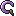 | **Crescent Blade** \* | netherite sword | - | - | *Not obtainable in survival yet* (give command only) | `/function slf:give/crescent_blade` `/function slf:weapons/give/crescent_blade` (3D) |
|  | **Garren's Iron Pickaxe** \* | iron pickaxe | - | On loan. Bring back ore. | Given when you accept The Iron Pickaxe | `/function slf:give/garrens_pickaxe` |
| 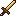 | **Gilta Brille** | golden sword | - | Crystal gauntlets crafted by Bilac. Right: Golden Stinger. Left: Twin crystal blasts. | *Not obtainable in survival yet* (give command only) | `/function slf:give/gilta_brille` `/function slf:weapons/give/gilta_brille` (3D) |
| 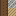 | **Goblin Hand Axe** \* | stone axe | - | A crude stone axe lashed to a stick. Every goblin carries one. | Carried by Goblin Drop: Goblin (player kills, 25%) | `/function slf:give/goblin_hand_axe` |
|  | **Iron Pickaxe (Reinforced)** \* | iron pickaxe | Efficiency 2, Unbreaking 2 | - | Quest reward: The Missing Miner | `/function slf:give/reinforced_pickaxe` |
| 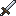 | **Mercenary Twin Blades (v1)** | iron sword | - | Mercenary twin blades - style v1. | *Not obtainable in survival yet* (give command only) | `/function slf:give/mercenary_twin_blades_v1` `/function slf:weapons/give/mercenary_blade` (3D) |
|  | **Mercenary Twin Blades (v2)** | iron sword | - | Mercenary twin blades - style v2. | *Not obtainable in survival yet* (give command only) | `/function slf:give/mercenary_twin_blades_v2` |
|  | **Redcap Iron Axe** \* | iron axe | - | Forged iron. Someone is teaching them. | Carried by Redcap Goblin Quest reward: Red Hoods in the Reeds Drop: Redcap Goblin (player kills, 20%) | `/function slf:give/redcap_axe` |
| 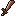 | **Rust Saber** \* | iron sword | - | A worn blade from the early days of Sunraku's journey. | *Not obtainable in survival yet* (give command only) | `/function slf:give/rust_saber` `/function slf:weapons/give/rust_saber` (3D) |
| 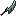 | **Togetsu: Waning** | iron sword | - | Rabbit Moon - Waning. The black left blade, forged by Vysache. / *Evolves into Whalelore* | Advancement: Twin Moons | `/function slf:give/togetsu_waning` |
|  | **Togetsu: Waning (v2)** | iron sword | - | Togetsu Waning - redesign v2. / *Evolves into Whalelore* | *Not obtainable in survival yet* (give command only) | `/function slf:give/togetsu_waning_v2` |
|  | **Togetsu: Waxing** | iron sword | - | Rabbit Moon - Waxing. The white right blade, forged by Vysache. / *Evolves into Whalelore* | Advancement: Twin Moons Advancement: Right Blade | `/function slf:give/togetsu_waxing` `/function slf:weapons/give/togetsu` (3D) |
| 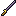 | **Wethermon's Blade** | netherite sword | - | The blade of Wethermon the Tombguard. Forged in samurai steel. | Advancement: Shangri-La Frontier Carried by Wethermon the Tombguard (boss) | `/function slf:give/wethermon_katana` `/function slf:weapons/give/wethermon_katana` (3D) |
| 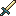 | **Whalelore: Goldsheen** | diamond sword | - | Togetsu ascended. The longer Goldsheen blade of the Whalelore pair. / *Togetsu, evolved* | Advancement: Whalelore | `/function slf:give/whalelore_goldsheen` `/function slf:weapons/give/whalelore` (3D) |
|  | **Whalelore: Nether Light** | diamond sword | - | *Togetsu, evolved* | *Not obtainable in survival yet* (give command only) | `/function slf:give/whalelore_netherlight` |

## Armour and accessories (14)

| | Item | Base | Stats | Description | Where it comes from | Give command |
|---|---|---|---|---|---|---|
|  | **Basic Iron Chestplate** \* | iron chestplate | - | - | Quest reward: The Iron Pickaxe | `/function slf:give/basic_iron_chestplate` |
|  | **Battlehorn Helm "4A"** | iron helmet | - | - | *Not obtainable in survival yet* (give command only) | `/function slf:give/helm_battlehorn` |
|  | **Garren's Plated Vambraces** \* | paper | +4 armor (offhand), +10% knockback resistance | Hold in your off hand: +4 armour, +10% knockback resistance. | Quest reward: Path to Thirdrema | `/function slf:give/plated_vambraces` |
|  | **Guard Issue Cloak** \* | leather chestplate | dyed | - | Quest reward: The Night Watch | `/function slf:give/guard_cloak` |
|  | **Guardian's Great Boots** | iron boots | - | - | *Not obtainable in survival yet* (give command only) | `/function slf:give/boots_guardian` |
|  | **Guardian's Great Chestplate** | iron chestplate | - | - | *Not obtainable in survival yet* (give command only) | `/function slf:give/chest_guardian` |
|  | **Guardian's Great Helm** | iron helmet | - | - | *Not obtainable in survival yet* (give command only) | `/function slf:give/helm_guardian` |
|  | **Guardian's Great Leggings** | iron leggings | - | - | *Not obtainable in survival yet* (give command only) | `/function slf:give/legs_guardian` |
|  | **Lacedaemon Girdle** | diamond leggings | - | - | *Not obtainable in survival yet* (give command only) | `/function slf:give/belt_lacedaemon` |
|  | **Lacedaemon Helm** | diamond helmet | - | - | *Not obtainable in survival yet* (give command only) | `/function slf:give/helm_lacedaemon` |
|  | **Splitblade Boots** | leather boots | - | - | *Not obtainable in survival yet* (give command only) | `/function slf:give/boots_splitblade` |
|  | **Splitblade Mask** | leather helmet | - | - | *Not obtainable in survival yet* (give command only) | `/function slf:give/mask_splitblade` |
|  | **Splitblade Pants** | leather leggings | - | - | *Not obtainable in survival yet* (give command only) | `/function slf:give/pants_splitblade` |
|  | **Splitblade Vest** | leather chestplate | - | - | *Not obtainable in survival yet* (give command only) | `/function slf:give/chest_splitblade` |

## Skill books (11)

| | Item | Base | Stats | Description | Where it comes from | Give command |
|---|---|---|---|---|---|---|
|  | **Seiten Skillbook** | enchanted book | - | A memory bank containing the skills of an Age of Divinity master swordsman. | Advancement: Wethermon Falls Drop: Wethermon the Tombguard (boss) (always) | `/function slf:give/seiten_skillbook` |
|  | **Skill Book: Blade Rush** | enchanted book | - | - | *Not obtainable in survival yet* (give command only) | `/function slf:give/skill_book_blade_rush` |
|  | **Skill Book: Moonhowl** | enchanted book | - | - | *Not obtainable in survival yet* (give command only) | `/function slf:give/skill_book_moonhowl` |
|  | **Skill Book: Slash** | enchanted book | - | - | *Not obtainable in survival yet* (give command only) | `/function slf:give/skill_book_slash` |
|  | **Skill Book: Thrust** | enchanted book | - | - | *Not obtainable in survival yet* (give command only) | `/function slf:give/skill_book_thrust` |
|  | **Skill Book: Void Lance** | enchanted book | - | - | *Not obtainable in survival yet* (give command only) | `/function slf:give/skill_book_void_lance` |
|  | **Skill: Flash Counter** | enchanted book | - | - | *Not obtainable in survival yet* (give command only) | `/function slf:give/skill_flash_counter` |
|  | **Skill: Formula Drift** | enchanted book | - | - | Advancement: Speed Demon | `/function slf:give/skill_formula_drift` |
|  | **Skill: Ignition** | enchanted book | - | - | Advancement: First Technique | `/function slf:give/skill_ignition` |
|  | **Skill: Meteor Fall** | enchanted book | - | - | *Not obtainable in survival yet* (give command only) | `/function slf:give/skill_meteor_fall` |
|  | **Skill: Skywalker** | enchanted book | - | - | Advancement: Rabituza | `/function slf:give/skill_skywalker` |

## Consumables (6)

| | Item | Base | Stats | Description | Where it comes from | Give command |
|---|---|---|---|---|---|---|
|  | **Antidote** \* | honey bottle | - | Cures poison. Lysa makes them daily. | Quest reward: Antidote Run Shop: Lysa (florist), 15 Mahni | `/function slf:give/antidote` |
|  | **Basic Health Potion** \* | potion | potion: healing | - | Quest reward: A Pioneer's Awakening Shop: Lysa (florist), 20 Mahni | `/function slf:give/health_potion` |
|  | **Fresh-Baked Bread** \* | bread | when eaten: instant health 5 | From home. A full heal. | Quest reward: A Brother's Letter (Wanderer) | `/function slf:give/fresh_baked_bread` |
|  | **Garren's Full Meal** \* | mushroom stew | when eaten: instant health 3, saturation 5 | - | Quest reward: Fellow Survivor (Wanderer) | `/function slf:give/garrens_full_meal` |
|  | **Secondil Stew** \* | mushroom stew | - | - | Quest reward: A Soft Bed at Last Shop: the Bartender, 5 Mahni | `/function slf:give/stew` |
|  | **Strong Ale** \* | potion | potion: strength 60s, nausea 8s | - | Quest reward: Bar Talk Shop: the Bartender, 10 Mahni | `/function slf:give/strong_ale` |

## Materials and trophies (10)

| | Item | Base | Stats | Description | Where it comes from | Give command |
|---|---|---|---|---|---|---|
|  | **Age of Divinity Memory** \* | book | - | - | Advancement: Inventoria | `/function slf:give/seiten_memory` |
|  | **Devourer's Scale** | paper | - | A square piece of hardened scale from the Ravenous Snake. | Quest reward: The Rampant Forest Guardian Drop: the Ravenous Snake (area boss) (1-2) | `/function slf:give/devourers_scale` |
|  | **Digger Hide** \* | paper | - | Crafting material for armour that resists knockback. | Drop: the Mud Digger (area boss) (1-2) | `/function slf:give/digger_hide` |
|  | **Gleaming Crystal Stinger** | book | - | - | *Not obtainable in survival yet* (give command only) | `/function slf:give/gleaming_crystal_stinger` |
|  | **Mud Digger Tooth** \* | paper | - | Crafting material for piercing weapons. | Drop: the Mud Digger (area boss) (1-3) | `/function slf:give/mud_digger_tooth` |
| 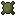 | **Mud Frog Skin** | book | - | - | Quest reward: Splitblade Set Drop: Mud Frog (player kills, 50%) Used in Splitblade Set (Garren) | `/function slf:give/mud_frog_skin` |
|  | **Python White Hair** | paper | - | A lock of white hair from the Ravenous Snake's mane. | Quest reward: The Rampant Forest Guardian Drop: the Ravenous Snake (area boss) (player kills, 50%) | `/function slf:give/python_white_hair` |
|  | **Quad Beetle Shell** | book | - | - | *Not obtainable in survival yet* (give command only) | `/function slf:give/quad_beetle_shell` |
|  | **Rabbit Neckband** | paper | - | A red cloth scarf, the kind every Vorpal Bunny wears. | Drop: Vorpal Bunny (player kills, 12%) | `/function slf:give/rabbit_neckband` |
| 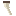 | **Ravenous Fang** | paper | - | The Ravenous Snake's fang. It never fails to drop. | Drop: the Ravenous Snake (area boss) (always) | `/function slf:give/ravenous_fang` |

## Quest items (5)

| | Item | Base | Stats | Description | Where it comes from | Give command |
|---|---|---|---|---|---|---|
|  | **A Sealed Letter** \* | paper | - | From the farmer in Firstia, for his brother Garren. | Quest reward: A Brother's Letter (Wanderer) | `/function slf:give/sealed_letter` |
|  | **Antidote Bundle** \* | paper | - | For the inn. Lysa's Antidote Run. | Given when you accept Antidote Run Quest reward: Antidote Run | `/function slf:give/antidote_bundle` |
|  | **Tomic's Journal** \* | written book | a readable book | Found half-buried in the Diremarsh mud. | Found at Tomic's dig site (The Missing Miner) | `/function slf:give/tomic_journal` |
|  | **Unknown Sigil Banner** \* | black banner | banner with an unknown sigil | A heraldic mark nobody in Secondil recognises. | Left at the Redcap camp (Red Hoods in the Reeds) | `/function slf:give/sigil_banner` |
|  | **Wild Herb** \* | paper | - | A medicinal herb from the grass outside Firstia. | Quest reward: A Pioneer's Awakening | `/function slf:give/wild_herb` |

## Currency (1)

| | Item | Base | Stats | Description | Where it comes from | Give command |
|---|---|---|---|---|---|---|
| 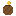 | **Mahni Purse** | paper | - | 10 Mahni. Added to your purse when you pick it up. | Drop: Goblin (player kills, 30%) Drop: the Mud Digger (area boss) (10-15, player kills) Drop: Orc (1-2, player kills) Drop: the Ravenous Snake (area boss) (5-8, player kills) Drop: Redcap Goblin (1-2, player kills) | `/function slf:give/mahni_purse` |

## 3D weapons pack (21)

Weapons that only the separate weapons data and resource packs have.

| | Item | Base | Stats | Description | Where it comes from | Give command |
|---|---|---|---|---|---|---|
| 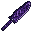 | **Antinomy** | netherite sword | damage 13, speed 0.9 | - | The 3D weapons pack (`weapons/`) | `/function slf:weapons/give/antinomy` |
| 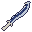 | **Blue Predator** | diamond sword | damage 9, speed 1.6 | - | The 3D weapons pack (`weapons/`) | `/function slf:weapons/give/blue_predator` |
|  | **Holy Spear Caledfwlch** | stick | damage 11, speed 1.3 | - | The 3D weapons pack (`weapons/`) | `/function slf:weapons/give/caledfwlch` |
|  | **Dis Pater** | shield | - | - | The 3D weapons pack (`weapons/`) | `/function slf:weapons/give/dis_pater` |
| 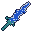 | **Ducusram** | diamond sword | damage 8, speed 2.6 | *Marsh Daggers, evolved* | The 3D weapons pack (`weapons/`) | `/function slf:weapons/give/ducusram` |
| 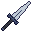 | **General Dullahan's Decapitator** | iron sword | damage 11, speed 1 | - | The 3D weapons pack (`weapons/`) | `/function slf:weapons/give/dullahan_decapitator` |
| 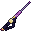 | **Empire Bee Twin** | diamond sword | damage 7, speed 2.6 | - | The 3D weapons pack (`weapons/`) | `/function slf:weapons/give/empire_bee_twinblade` |
| 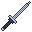 | **Flame General's Decapitator** | diamond sword | damage 12, speed 1.2 | *General Dullahan's Decapitator, reforged* | The 3D weapons pack (`weapons/`) | `/function slf:weapons/give/flame_decapitator` |
| 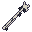 | **Fossil Rod** | stick | damage 3, speed 1.6 | - | The 3D weapons pack (`weapons/`) | `/function slf:weapons/give/fossil_rod` |
| 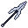 | **Giant-Killing Skewer** | stick | damage 9, speed 1.2 | - | The 3D weapons pack (`weapons/`) | `/function slf:weapons/give/giant_killing_skewer` |
| 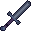 | **Iron Dagger** | iron sword | damage 4, speed 2.4 | - | Quest reward: Clearing the Outskirts The 3D weapons pack (`weapons/`) | `/function slf:weapons/give/iron_dagger` |
| 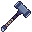 | **Iron Hammer** | stick | damage 8, speed 0.8 | - | The 3D weapons pack (`weapons/`) | `/function slf:weapons/give/iron_hammer` |
| 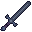 | **Iron Sword** | iron sword | damage 6, speed 1.6 | - | The 3D weapons pack (`weapons/`) | `/function slf:weapons/give/iron_sword` |
| 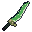 | **Marsh Daggers** | iron sword | damage 5, speed 2.6 | *Evolves into Ducusram* | The 3D weapons pack (`weapons/`) | `/function slf:weapons/give/marsh_dagger` |
| 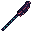 | **Slaughter Bringer** | stick | damage 10, speed 1.2 | - | The 3D weapons pack (`weapons/`) | `/function slf:weapons/give/slaughter_bringer` |
|  | **Super Cat-Teaser Lv.100** | iron sword | damage 6, speed 2 | - | The 3D weapons pack (`weapons/`) | `/function slf:weapons/give/super_cat_teaser` |
| 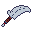 | **Vorpal Choppers** | iron sword | damage 7, speed 2.4 | - | Advancement: Vorpal Hunter Drop: Vorpal Bunny (player kills, 5%) The 3D weapons pack (`weapons/`) | `/function slf:weapons/give/vorpal_chopper` |
| 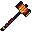 | **Vorpal Sledge** | stick | damage 10, speed 0.8 | - | The 3D weapons pack (`weapons/`) | `/function slf:weapons/give/vorpal_sledge` |
| 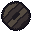 | **Wood Shield** | shield | - | - | The 3D weapons pack (`weapons/`) | `/function slf:weapons/give/wood_shield` |
| 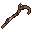 | **Wood Staff** | stick | damage 4, speed 1.4 | - | The 3D weapons pack (`weapons/`) | `/function slf:weapons/give/wood_staff` |
| 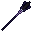 | **Darkhelm Spear Zanbaralia** | stick | damage 9, speed 1.4 | - | The 3D weapons pack (`weapons/`) | `/function slf:weapons/give/zanbaralia` |
