# SLF items

Every item in the SLF packs: 82 in the main packs and 33 in the 3D weapons pack. Generated by
`tools/gen_item_docs.py` from the packs themselves - don't edit this file by hand; re-run the tool after changing an item.

*Give commands* need OP. `/function slf:test/menu` has kits with most of them. *Stats* show weapon damage and attack speed
the way the game's tooltip does, plus enchantments and other modifiers. Items without a custom icon use the vanilla
item's look.

**30 items are not obtainable in survival yet**: they exist in the packs but no monster, quest or shop gives
them. They're marked in the tables below.

## Weapons (26)

| | Item | Base | Stats | Description | Where it comes from | Give command |
|---|---|---|---|---|---|---|
| 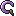 | **Bilac's Crescent Blade** | netherite sword | Sharpness 4, Looting 2 | Unique Drop — Bilac the Full Moon Fangs | Drop: Bilac the Full Moon Fangs (boss) (always) | `/function slf:give/bilac_crescent_blade` |
| 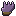 | **Bilac's Fang Gauntlet** | netherite sword | - | - | *Not obtainable in survival yet* (give command only) | `/function slf:give/bilac_fang_gauntlet` |
|  | **Garren's Iron Pickaxe** | iron pickaxe | - | On loan. Bring back ore. | Given when you accept The Iron Pickaxe | `/function slf:give/garrens_pickaxe` |
| 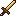 | **Gilta Brille** | golden sword | - | Crystal gauntlets crafted by Bilac. Right: Golden Stinger. Left: Twin crystal blasts. | *Not obtainable in survival yet* (give command only) | `/function slf:give/gilta_brille` |
| 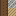 | **Goblin Hand Axe** | stone axe | - | A crude stone axe lashed to a stick. Every goblin carries one. | Carried by Goblin Drop: Goblin (player kills, 25%) | `/function slf:give/goblin_hand_axe` |
|  | **Iron Pickaxe (Reinforced)** | iron pickaxe | Efficiency 2, Unbreaking 2 | - | Quest reward: The Missing Miner | `/function slf:give/reinforced_pickaxe` |
|  | **Lycagon's Fang** | netherite sword | - | A shadow-infused fang torn from Lycagon the Nightslayer. | Advancement: Colossus Hunter Advancement: Grand Capture Advancement: Nightslayer Drop: Lycagon the Nightslayer (boss) (always) | `/function slf:give/lycagon_fang` |
| 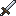 | **Mercenary Twin Blades (v1)** | iron sword | - | Mercenary twin blades - style v1. | *Not obtainable in survival yet* (give command only) | `/function slf:give/mercenary_twin_blades_v1` |
|  | **Mercenary Twin Blades (v2)** | iron sword | - | Mercenary twin blades - style v2. | *Not obtainable in survival yet* (give command only) | `/function slf:give/mercenary_twin_blades_v2` |
| 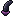 | **Nightclaw Talon** | netherite sword | Sharpness 5, Fire Aspect 2 | A razor talon born of eternal darkness. | Drop: Nightclaw (boss) (always) | `/function slf:give/nightclaw_talon` |
| 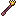 | **Oriana's Scepter** | diamond sword | - | - | *Not obtainable in survival yet* (give command only) | `/function slf:give/oriana_scepter` |
| 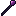 | **Oriana's Void Staff** | diamond sword | Smite 5, Knockback 3 | Unique Drop — Oriana the Uncrowned / Channels void energy through its twisted frame. | Drop: Oriana the Uncrowned (boss) (always) | `/function slf:give/oriana_void_staff` |
|  | **Redcap Iron Axe** | iron axe | - | Forged iron. Someone is teaching them. | Carried by Redcap Goblin Quest reward: Red Hoods in the Reeds Drop: Redcap Goblin (player kills, 20%) | `/function slf:give/redcap_axe` |
| 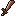 | **Rust Saber** | iron sword | - | A worn blade from the early days of Sunraku's journey. | *Not obtainable in survival yet* (give command only) | `/function slf:give/rust_saber` |
| 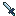 | **Sunraku's Blade (Left)** | iron sword | - | - | *Not obtainable in survival yet* (give command only) | `/function slf:give/sunraku_blade_l` |
|  | **Sunraku's Blade (Right)** | iron sword | - | - | *Not obtainable in survival yet* (give command only) | `/function slf:give/sunraku_blade_r` |
| 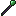 | **Sunraku's Chaos Rod** | iron sword | - | - | *Not obtainable in survival yet* (give command only) | `/function slf:give/sunraku_chaos_rod` |
| 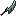 | **Togetsu: Waning** | iron sword | - | Rabbit Moon - Waning. The black left blade, forged by Vysache. | Advancement: Twin Moons | `/function slf:give/togetsu_waning` |
|  | **Togetsu: Waning (v2)** | iron sword | - | Togetsu Waning - redesign v2. | *Not obtainable in survival yet* (give command only) | `/function slf:give/togetsu_waning_v2` |
|  | **Togetsu: Waxing** | iron sword | - | Rabbit Moon - Waxing. The white right blade, forged by Vysache. | Advancement: Twin Moons Advancement: Right Blade | `/function slf:give/togetsu_waxing` |
|  | **Vorpal Knife** | iron sword | - | A dagger carved from Vorpal Bunny fang. 5% drop chance. | Advancement: Vorpal Hunter Drop: Vorpal Bunny (5%) | `/function slf:give/vorpal_knife` |
| 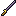 | **Wethermon's Blade** | netherite sword | - | The blade of Wethermon the Tombguard. Forged in samurai steel. | Advancement: Colossus Hunter Advancement: Shangri-La Frontier | `/function slf:give/wethermon_katana` |
| 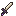 | **Wethermon's Rib Dagger** | netherite sword | - | - | *Not obtainable in survival yet* (give command only) | `/function slf:give/wethermon_rib_dagger` |
| 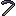 | **Wethermon's Scythe** | netherite sword | Sharpness 5 | Unique Drop — Wethermon the Tombguard / A bone scythe of immense weight. | Carried by Wethermon the Tombguard (boss) Drop: Wethermon the Tombguard (boss) (always) | `/function slf:give/wethermon_scythe` |
| 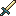 | **Whalelore: Goldsheen** | diamond sword | - | Togetsu ascended. The longer Goldsheen blade of the Whalelore pair. | Advancement: Whalelore Advancement: Colossus Hunter Advancement: Grand Capture | `/function slf:give/whalelore_goldsheen` |
|  | **Whalelore: Netherlight** | diamond sword | - | - | *Not obtainable in survival yet* (give command only) | `/function slf:give/whalelore_netherlight` |

## Armour and accessories (19)

| | Item | Base | Stats | Description | Where it comes from | Give command |
|---|---|---|---|---|---|---|
|  | **Basic Iron Chestplate** | iron chestplate | - | - | Quest reward: The Iron Pickaxe | `/function slf:give/basic_iron_chestplate` |
|  | **Battlehorn Helm "4A"** | iron helmet | - | - | *Not obtainable in survival yet* (give command only) | `/function slf:give/helm_battlehorn` |
|  | **Fullmoon Chestplate** | diamond chestplate | - | - | *Not obtainable in survival yet* (give command only) | `/function slf:give/chestplate_fullmoon` |
|  | **Garren's Plated Vambraces** | paper | +4 armor (offhand), +10% knockback resistance | Hold in your off hand: +4 armour, +10% knockback resistance. | Quest reward: Path to Thirdrema | `/function slf:give/plated_vambraces` |
|  | **Guard Issue Cloak** | leather chestplate | dyed | - | Quest reward: The Night Watch | `/function slf:give/guard_cloak` |
|  | **Guardian's Great Boots** | iron boots | - | - | *Not obtainable in survival yet* (give command only) | `/function slf:give/boots_guardian` |
|  | **Guardian's Great Chestplate** | iron chestplate | - | - | *Not obtainable in survival yet* (give command only) | `/function slf:give/chest_guardian` |
|  | **Guardian's Great Helm** | iron helmet | - | - | *Not obtainable in survival yet* (give command only) | `/function slf:give/helm_guardian` |
|  | **Guardian's Great Leggings** | iron leggings | - | - | *Not obtainable in survival yet* (give command only) | `/function slf:give/legs_guardian` |
|  | **Lacedaemon Girdle** | diamond leggings | - | - | *Not obtainable in survival yet* (give command only) | `/function slf:give/belt_lacedaemon` |
|  | **Lacedaemon Helm** | diamond helmet | - | - | *Not obtainable in survival yet* (give command only) | `/function slf:give/helm_lacedaemon` |
|  | **Splitblade Boots** | leather boots | - | - | *Not obtainable in survival yet* (give command only) | `/function slf:give/boots_splitblade` |
|  | **Splitblade Mask** | leather helmet | - | - | Quest reward: Splitblade Set | `/function slf:give/mask_splitblade` |
|  | **Splitblade Pants** | leather leggings | - | - | Quest reward: Splitblade Set | `/function slf:give/pants_splitblade` |
|  | **Splitblade Vest** | leather chestplate | - | - | Quest reward: Splitblade Set | `/function slf:give/chest_splitblade` |
|  | **Tombguard Boots** | netherite boots | - | - | Advancement: Bone Knight Advancement: The Tombguard Awaits Drop: Wethermon the Tombguard (boss) (player kills, 50%) | `/function slf:give/boots_tombguard` |
| 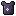 | **Tombguard Chestplate** | netherite chestplate | - | - | Advancement: Bone Knight Advancement: The Tombguard Awaits Drop: Wethermon the Tombguard (boss) (player kills, 50%) | `/function slf:give/chest_tombguard` |
|  | **Tombguard Helmet** | netherite helmet | - | - | Advancement: Bone Knight Advancement: The Tombguard Awaits Drop: Wethermon the Tombguard (boss) (player kills, 50%) | `/function slf:give/helm_tombguard` |
|  | **Tombguard Leggings** | netherite leggings | - | - | Advancement: Bone Knight Advancement: The Tombguard Awaits Drop: Wethermon the Tombguard (boss) (player kills, 50%) | `/function slf:give/legs_tombguard` |

## Skill books (15)

| | Item | Base | Stats | Description | Where it comes from | Give command |
|---|---|---|---|---|---|---|
|  | **Acrobat** | enchanted book | - | The Vorpal Bunny's leap. Resistance surges when your feet leave the ground. | Advancement: Vorpal Leap Teaches its skill when picked up Drop: Vorpal Bunny (player kills, 3%) | `/function slf:give/skill_acrobat` |
|  | **Gravity Zero** | enchanted book | - | Siegwurm's sky-dominion. Nullifies gravity's pull. | Advancement: Weightless Sky Teaches its skill when picked up Drop: Siegwurm the Sky Ruler (boss) (player kills, 30%) | `/function slf:give/skill_gravity_zero` |
|  | **Managarm Pride** | enchanted book | - | The power of the wolf-god Lycagon. Strength grows with each wound. | Advancement: Wolf-God's Pride Teaches its skill when picked up Drop: Lycagon the Nightslayer (boss) (player kills, 25%) | `/function slf:give/skill_managarm_pride` |
|  | **Reflexus** | enchanted book | - | Ctarnidd's stolen patterns. Briefly mirror the last attack that struck you. | Advancement: Stolen Patterns Teaches its skill when picked up Drop: Ctarnidd of the Abyss (boss) (player kills, 30%) | `/function slf:give/skill_reflexus` |
|  | **Seiten Skillbook** | enchanted book | - | A memory bank containing the skills of an Age of Divinity master swordsman. | Advancement: Grand Capture Advancement: Wethermon Falls Drop: Wethermon the Tombguard (boss) (always) | `/function slf:give/seiten_skillbook` |
|  | **Skill Book: Blade Rush** | enchanted book | - | - | *Not obtainable in survival yet* (give command only) | `/function slf:give/skill_book_blade_rush` |
|  | **Skill Book: Moonhowl** | enchanted book | - | - | *Not obtainable in survival yet* (give command only) | `/function slf:give/skill_book_moonhowl` |
|  | **Skill Book: Slash** | enchanted book | - | - | *Not obtainable in survival yet* (give command only) | `/function slf:give/skill_book_slash` |
|  | **Skill Book: Thrust** | enchanted book | - | - | *Not obtainable in survival yet* (give command only) | `/function slf:give/skill_book_thrust` |
|  | **Skill Book: Void Lance** | enchanted book | - | - | *Not obtainable in survival yet* (give command only) | `/function slf:give/skill_book_void_lance` |
|  | **Skill: Flash Counter** | enchanted book | - | - | *Not obtainable in survival yet* (give command only) | `/function slf:give/skill_flash_counter` |
|  | **Skill: Formula Drift** | enchanted book | - | - | Advancement: Speed Demon | `/function slf:give/skill_formula_drift` |
|  | **Skill: Ignition** | enchanted book | - | - | Advancement: First Technique | `/function slf:give/skill_ignition` |
|  | **Skill: Meteor Fall** | enchanted book | - | - | *Not obtainable in survival yet* (give command only) | `/function slf:give/skill_meteor_fall` |
|  | **Skill: Skywalker** | enchanted book | - | - | Advancement: Rabituza | `/function slf:give/skill_skywalker` |

## Consumables (6)

| | Item | Base | Stats | Description | Where it comes from | Give command |
|---|---|---|---|---|---|---|
|  | **Antidote** | honey bottle | - | Cures poison. Lysa makes them daily. | Quest reward: Antidote Run Shop: Lysa (florist), 15 Mahni | `/function slf:give/antidote` |
|  | **Basic Health Potion** | potion | potion: healing | - | Quest reward: A Pioneer's Awakening Shop: Lysa (florist), 20 Mahni | `/function slf:give/health_potion` |
|  | **Fresh-Baked Bread** | bread | when eaten: instant health 5 | From home. A full heal. | Quest reward: A Brother's Letter (Wanderer) | `/function slf:give/fresh_baked_bread` |
|  | **Garren's Full Meal** | mushroom stew | when eaten: instant health 3, saturation 5 | - | Quest reward: Fellow Survivor (Wanderer) | `/function slf:give/garrens_full_meal` |
|  | **Secondil Stew** | mushroom stew | - | - | Quest reward: A Soft Bed at Last Shop: the Bartender, 5 Mahni | `/function slf:give/stew` |
|  | **Strong Ale** | potion | potion: strength 60s, nausea 8s | - | Quest reward: Bar Talk Shop: the Bartender, 10 Mahni | `/function slf:give/strong_ale` |

## Materials and trophies (10)

| | Item | Base | Stats | Description | Where it comes from | Give command |
|---|---|---|---|---|---|---|
|  | **Age of Divinity Memory** | book | - | - | Advancement: Grand Capture Advancement: Inventoria | `/function slf:give/seiten_memory` |
|  | **Devourer's Scale** | paper | - | A square piece of hardened scale from the Ravenous Snake. | Quest reward: The Rampant Forest Guardian Drop: the Ravenous Snake (area boss) (1-2) | `/function slf:give/devourers_scale` |
|  | **Digger Hide** | paper | - | Crafting material for armour that resists knockback. | Drop: the Mud Digger (area boss) (1-2) | `/function slf:give/digger_hide` |
|  | **Gleaming Crystal Stinger** | book | - | - | *Not obtainable in survival yet* (give command only) | `/function slf:give/gleaming_crystal_stinger` |
|  | **Mud Digger Tooth** | paper | - | Crafting material for piercing weapons. | Drop: the Mud Digger (area boss) (1-3) | `/function slf:give/mud_digger_tooth` |
| 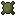 | **Mud Frog Skin** | book | - | - | Quest reward: Splitblade Set Drop: Mud Frog (player kills, 50%) Used in Splitblade Set (Garren) | `/function slf:give/mud_frog_skin` |
|  | **Python White Hair** | paper | - | A lock of white hair from the Ravenous Snake's mane. | Quest reward: The Rampant Forest Guardian Drop: the Ravenous Snake (area boss) (player kills, 50%) | `/function slf:give/python_white_hair` |
|  | **Quad Beetle Shell** | book | - | - | *Not obtainable in survival yet* (give command only) | `/function slf:give/quad_beetle_shell` |
|  | **Solo Killer's Trophy** | paper | - | Defeated the Mud Digger alone. Brave, or foolish. | Carried by the Mud Digger (area boss) | `/function slf:give/solo_killers_trophy` |
|  | **Unique Monster Core** | book | - | - | Advancement: Grand Capture Advancement: Sky Ruler Drop: Siegwurm the Sky Ruler (boss) (always) | `/function slf:give/unique_core` |

## Quest items (5)

| | Item | Base | Stats | Description | Where it comes from | Give command |
|---|---|---|---|---|---|---|
|  | **A Sealed Letter** | paper | - | From the farmer in Firstia, for his brother Garren. | Quest reward: A Brother's Letter (Wanderer) | `/function slf:give/sealed_letter` |
|  | **Antidote Bundle** | paper | - | For the inn. Lysa's Antidote Run. | Given when you accept Antidote Run Quest reward: Antidote Run | `/function slf:give/antidote_bundle` |
|  | **Tomic's Journal** | written book | a readable book | Found half-buried in the Diremarsh mud. | Found at Tomic's dig site (The Missing Miner) | `/function slf:give/tomic_journal` |
|  | **Unknown Sigil Banner** | black banner | banner with an unknown sigil | A heraldic mark nobody in Secondil recognises. | Left at the Redcap camp (Red Hoods in the Reeds) | `/function slf:give/sigil_banner` |
|  | **Wild Herb** | paper | - | A medicinal herb from the grass outside Firstia. | Quest reward: A Pioneer's Awakening | `/function slf:give/wild_herb` |

## Currency (1)

| | Item | Base | Stats | Description | Where it comes from | Give command |
|---|---|---|---|---|---|---|
| 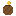 | **Mahni Purse** | paper | - | 10 Mahni. Added to your purse when you pick it up. | Drop: Goblin (player kills, 30%) Drop: the Mud Digger (area boss) (10-15, player kills) Drop: Orc (1-2, player kills) Drop: the Ravenous Snake (area boss) (5-8, player kills) Drop: Redcap Goblin (1-2, player kills) | `/function slf:give/mahni_purse` |

## 3D weapons pack (33)

These need the separate weapons data and resource packs.

| | Item | Base | Stats | Description | Where it comes from | Give command |
|---|---|---|---|---|---|---|
| 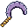 | **Bilac's Crescent Blade** | iron sword | damage 8, speed 1.4 | - | The 3D weapons pack (`weapons/`) | `/function slf:weapons/give/bilac_crescent_blade` |
|  | **Bilac's Fang Gauntlet** | iron sword | damage 7, speed 2 | - | The 3D weapons pack (`weapons/`) | `/function slf:weapons/give/bilac_fang_gauntlet` |
| 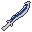 | **Blue Predator** | diamond sword | damage 9, speed 1.6 | - | The 3D weapons pack (`weapons/`) | `/function slf:weapons/give/blue_predator` |
|  | **Dis Pater** | shield | - | - | The 3D weapons pack (`weapons/`) | `/function slf:weapons/give/dis_pater` |
| 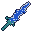 | **Ducusram** | diamond sword | damage 8, speed 2.6 | - | The 3D weapons pack (`weapons/`) | `/function slf:weapons/give/ducusram` |
| 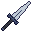 | **General Dullahan's Decapitator** | iron sword | damage 11, speed 1 | - | The 3D weapons pack (`weapons/`) | `/function slf:weapons/give/dullahan_decapitator` |
| 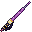 | **Empire Bee Twinblade** | diamond sword | damage 7, speed 2.6 | - | The 3D weapons pack (`weapons/`) | `/function slf:weapons/give/empire_bee_twinblade` |
| 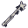 | **Fossil Rod** | stick | damage 3, speed 1.6 | - | The 3D weapons pack (`weapons/`) | `/function slf:weapons/give/fossil_rod` |
| 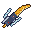 | **Gilta Brille** | golden sword | damage 8, speed 2 | - | The 3D weapons pack (`weapons/`) | `/function slf:weapons/give/gilta_brille` |
| 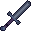 | **Iron Dagger** | iron sword | damage 4, speed 2.4 | - | Quest reward: Clearing the Outskirts The 3D weapons pack (`weapons/`) | `/function slf:weapons/give/iron_dagger` |
| 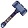 | **Iron Hammer** | stick | damage 8, speed 0.8 | - | The 3D weapons pack (`weapons/`) | `/function slf:weapons/give/iron_hammer` |
| 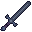 | **Iron Sword** | iron sword | damage 6, speed 1.6 | - | The 3D weapons pack (`weapons/`) | `/function slf:weapons/give/iron_sword` |
| 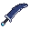 | **Lycagon's Fang** | netherite sword | damage 9, speed 1.8 | - | The 3D weapons pack (`weapons/`) | `/function slf:weapons/give/lycagon_fang` |
| 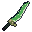 | **Marsh Daggers** | iron sword | damage 5, speed 2.6 | - | The 3D weapons pack (`weapons/`) | `/function slf:weapons/give/marsh_dagger` |
| 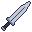 | **Mercenary Twinblades** | iron sword | damage 6, speed 2.2 | - | The 3D weapons pack (`weapons/`) | `/function slf:weapons/give/mercenary_blade` |
| 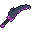 | **Nightclaw Talon** | iron sword | damage 7, speed 2.2 | - | The 3D weapons pack (`weapons/`) | `/function slf:weapons/give/nightclaw_talon` |
| 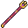 | **Oriana's Scepter** | stick | damage 5, speed 1.4 | - | The 3D weapons pack (`weapons/`) | `/function slf:weapons/give/oriana_scepter` |
| 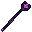 | **Oriana's Void Staff** | stick | damage 6, speed 1.2 | - | The 3D weapons pack (`weapons/`) | `/function slf:weapons/give/oriana_void_staff` |
| 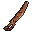 | **Rust Saber** | iron sword | damage 5, speed 1.8 | - | The 3D weapons pack (`weapons/`) | `/function slf:weapons/give/rust_saber` |
| 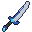 | **Sunraku's Blades** | iron sword | damage 6, speed 2.4 | - | The 3D weapons pack (`weapons/`) | `/function slf:weapons/give/sunraku_blade` |
| 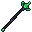 | **Sunraku's Chaos Rod** | stick | damage 5, speed 1.4 | - | The 3D weapons pack (`weapons/`) | `/function slf:weapons/give/sunraku_chaos_rod` |
|  | **Super Cat-Teaser Lv.100** | iron sword | damage 6, speed 2 | - | The 3D weapons pack (`weapons/`) | `/function slf:weapons/give/super_cat_teaser` |
| 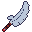 | **Togetsu** | iron sword | damage 8, speed 2.4 | - | The 3D weapons pack (`weapons/`) | `/function slf:weapons/give/togetsu` |
| 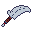 | **Vorpal Choppers** | iron sword | damage 7, speed 2.4 | - | Drop: Vorpal Bunny (player kills, 4%) The 3D weapons pack (`weapons/`) | `/function slf:weapons/give/vorpal_chopper` |
| 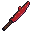 | **Vorpal Knife** | iron sword | damage 5, speed 2.6 | - | The 3D weapons pack (`weapons/`) | `/function slf:weapons/give/vorpal_knife` |
| 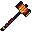 | **Vorpal Sledge** | stick | damage 10, speed 0.8 | - | The 3D weapons pack (`weapons/`) | `/function slf:weapons/give/vorpal_sledge` |
| 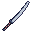 | **Wethermon's Blade** | netherite sword | damage 10, speed 1.6 | - | The 3D weapons pack (`weapons/`) | `/function slf:weapons/give/wethermon_katana` |
| 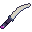 | **Wethermon's Rib Dagger** | netherite sword | damage 7, speed 2.4 | - | The 3D weapons pack (`weapons/`) | `/function slf:weapons/give/wethermon_rib_dagger` |
| 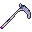 | **Wethermon's Scythe** | netherite sword | damage 11, speed 1 | - | The 3D weapons pack (`weapons/`) | `/function slf:weapons/give/wethermon_scythe` |
| 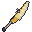 | **Whalelore: Goldsheen** | diamond sword | damage 8, speed 1.6 | - | The 3D weapons pack (`weapons/`) | `/function slf:weapons/give/whalelore_goldsheen` |
| 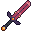 | **Whalelore: Netherlight** | diamond sword | damage 7, speed 2 | - | The 3D weapons pack (`weapons/`) | `/function slf:weapons/give/whalelore_netherlight` |
| 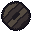 | **Wood Shield** | shield | - | - | The 3D weapons pack (`weapons/`) | `/function slf:weapons/give/wood_shield` |
| 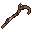 | **Wood Staff** | stick | damage 4, speed 1.4 | - | The 3D weapons pack (`weapons/`) | `/function slf:weapons/give/wood_staff` |
